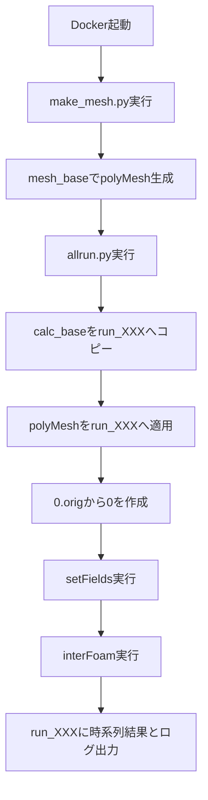

# BIOMOD_MICROFLUIDICS_2026 構成・設定ファイル解説

この文書は、OpenFOAMベースの液滴生成シミュレーション環境を、初見のエンジニアでも追えるように整理した引き継ぎ資料です。

## 1. プロジェクトの目的と全体像

- 目的: マイクロ流路内での水/油二相流（液滴形成）を `interFoam` で解析する。
- 実行環境: Dockerコンテナ内に OpenFOAM v2312 + Python解析環境を構築。
- 運用方針:
  - メッシュ定義と生成は `cases/mesh_base` で管理。
  - 計算条件テンプレートは `cases/calc_base` で管理。
  - 実行ごとの計算ケースは `cases/run_XXX` として自動生成し、履歴を残す。

## 2. ディレクトリ責務

- `docker/`: 解析実行コンテナの定義。
- `scripts/`: メッシュ生成と実行起動の自動化スクリプト。
- `cases/mesh_base/`: 幾何・メッシュ生成設定（blockMesh/snappyHexMesh/topoSet/createPatch）。
- `cases/calc_base/`: 物理条件・数値解法・初期条件のテンプレート。
- `cases/run_XXX/`: 実行時に生成される実ケース（ログ、時系列結果を含む）。

## 3. 実行フロー

## 4. コンテナ・開発環境

### `docker-compose.yml`

- `openfoam-env` サービスを定義。
- プロジェクトルートを `/workspace` にマウント。
- `8888` を公開（JupyterLab利用想定）。
- デフォルトコマンドは `/bin/bash`。

### `docker/Dockerfile`

- ベース: Ubuntu 22.04。
- OpenFOAM: ESI版 `openfoam2312-default` をAPT経由で導入。
- `.bashrc` に OpenFOAM環境読込みを設定。
- Python依存を `docker/requirements.txt` からインストール。

### `docker/requirements.txt`

- 代表用途:
  - 数値処理: `numpy`, `scipy`, `pandas`
  - 可視化: `matplotlib`, `pyvista`
  - CFD補助: `PyFOAM`
  - 実験運用: `jupyterlab`, `optuna`

## 5. 自動化スクリプト

### `scripts/make_mesh.py`

責務: `cases/mesh_base` でメッシュ生成を完結。

処理順:
1. 既存メッシュと一時成果物を削除。
2. `flow_channel.stl` を `surfaceTransformPoints` で `0.001` 倍（mm→m）に変換。
3. `blockMesh` → `surfaceFeatureExtract` → `snappyHexMesh -overwrite` 実行。
4. `topoSet` で入口/出口候補面集合を抽出。
5. `createPatch -overwrite` で入口/出口パッチ名を確定。

生成物:
- 主に `cases/mesh_base/constant/polyMesh`
- ログ: `log.blockMesh`, `log.surfaceFeatureExtract`, `log.snappyHexMesh`, `log.topoSet`

注意点:
- STLが既にm単位なら、スケーリング実行は二重変換になるため要調整。

### `scripts/allrun.py`

責務: 計算ケース作成から `interFoam` 起動までを自動化。

処理順:
1. `cases/run_XXX` の次番号を採番して新規作成。
2. `cases/calc_base` を `run_XXX` にコピー。
3. `mesh_base/constant/polyMesh` を `run_XXX/constant/polyMesh` にコピー。
4. `run_XXX/0.orig` を `run_XXX/0` にコピー。
5. `setFields` 実行。
6. `interFoam` をバックグラウンド起動（`log.interFoam` へ出力）。

特徴:
- 実行履歴を `run_001`, `run_002`, ... と蓄積できる。
- 失敗時はその場で終了し、該当ログの確認を促す。

## 6. メッシュ設定ファイル（`cases/mesh_base/system`）

### `blockMeshDict`

- 背景直方体メッシュを定義。
- `convertToMeters 0.001` により座標を mm→m 変換。
- 分割数 `(145 120 10)` はベース解像度を規定。

### `surfaceFeatureExtractDict`

- STLのエッジ特徴を抽出し、`flow_channel.eMesh` を生成。
- snappyHexMesh の形状追従に使う。

### `snappyHexMeshDict`

- `castellatedMesh/snap` を有効、`addLayers` は無効。
- `geometry` で `flow_channel.stl` を参照。
- `features` で `flow_channel.eMesh` を参照。
- `refinementSurfaces` の `level (3 4)` で表面近傍解像度を制御。
- `locationInMesh` は「流体領域内」に置く必要がある。
- v2312で要求される設定が明示されている:
  - `mergeTolerance`
  - 空の `refinementRegions {}`
  - `allowFreeStandingZoneFaces`
  - 空の `addLayersControls {}`
  - `meshQualityControls` の各閾値

### `topoSetDict`

- box指定で入口/出口候補面を抽出し faceSet を作る。
- `subset; source boundaryToFace;` で境界面に限定。

### `createPatchDict`

- faceSet からパッチを生成:
  - `inlet_water`
  - `inlet_oil1`
  - `inlet_oil2`
  - `outlet`
- 指定外面は壁面（`flow_channel`）として残る。

### `fvSchemes`, `fvSolution`, `controlDict`（mesh_base側）

- 現状は `calc_base/system` と同等内容。
- メッシュ生成コマンド群自体はこれらを本質的に使わないため、運用上は「共通テンプレート兼バックアップ」的な位置づけ。

## 7. 計算設定ファイル（`cases/calc_base`）

### `system/controlDict`

- ソルバ: `interFoam`
- 計算時間: `0` 〜 `0.05 s`
- 出力間隔: `0.005 s`
- 可変時間刻み: `adjustTimeStep yes`
- 安定化閾値: `maxCo 0.5`, `maxAlphaCo 0.5`

### `system/fvSchemes`

- 時間離散: `Euler`
- 移流項:
  - `div(rhoPhi,U)`: `Gauss upwind`
  - `div(phi,alpha)`: `Gauss vanLeer`
  - `div(phirb,alpha)`: `Gauss linear`
- 粘性項 `div(((rho*nuEff)*dev2(T(grad(U)))))` を明示。
  - v2312 ではこの項の不足がエラー原因になりやすい。

### `system/fvSolution`

- 圧力 `p_rgh`: `PCG + DIC`
- 速度/相分率: `smoothSolver + symGaussSeidel`
- `PIMPLE`:
  - `nOuterCorrectors 1`
  - `nCorrectors 3`
  - `momentumPredictor no`

### `system/setFieldsDict`

- 初期場を油 (`alpha.water=0`) で満たし、指定box内のみ水 (`alpha.water=1`) に上書き。
- 初期水領域の位置・大きさを定義する重要ファイル。

### `constant/transportProperties`

- 相定義: `water`, `oil`
- 物性:
  - `water`: `nu=1e-06`, `rho=1000`
  - `oil`: `nu=5e-06`, `rho=900`
- 界面張力: `sigma=0.035`

### `constant/turbulenceProperties`

- `simulationType laminar`（層流モデル）

### `constant/g`

- 重力ベクトル `(0 0 0)`。
- つまり重力を考慮しない設定。

### `0.orig/U`

- 初期速度はゼロ。
- 入口速度BCは `pressureInletOutletVelocity`、出口は `zeroGradient`、壁は `noSlip`。

### `0.orig/p_rgh`

- 入口・出口の圧力駆動条件を定義。
- 現状は油側入口圧を水側より高めに設定。

### `0.orig/alpha.water`

- 水相体積率の境界条件。
- 水入口=1、油入口=0。
- 壁面は `constantAlphaContactAngle` で接触角 `theta0=110`（疎水性想定）。

## 8. run_XXX の見方

- `0`, `0.005`, `0.01`, ...: 各時刻の場データ。
- `log.setFields`, `log.interFoam`: 実行ログ。
- `result.foam`: ParaView連携用エントリ。

## 9. 変更時の影響範囲（実務で重要）

- 幾何・境界位置変更:
  - 変更対象: STL, `topoSetDict`, `createPatchDict`, `snappyHexMeshDict`
  - 影響: パッチ抽出失敗、入口出口の取り違え

- 物性・濡れ性変更:
  - 変更対象: `transportProperties`, `alpha.water`
  - 影響: 液滴サイズ、ちぎれ方、界面安定性

- 安定性/計算速度調整:
  - 変更対象: `controlDict`, `fvSchemes`, `fvSolution`
  - 影響: 収束性、計算時間、数値拡散

- 初期液柱位置変更:
  - 変更対象: `setFieldsDict`
  - 影響: 過渡初期挙動、液滴生成開始タイミング

## 10. 推奨オペレーション

1. コンテナ起動
2. `scripts/make_mesh.py` 実行
3. `scripts/allrun.py` 実行
4. `cases/run_XXX/log.interFoam` を監視
5. 結果可視化（ParaView, PyVista等）

## 11. 最低限の引き継ぎチェック項目

- `mesh_base/constant/polyMesh` が最新STL由来か。
- `createPatch` 後に境界名が期待通りか（入口3種 + 出口 + 壁）。
- `run_XXX/0` の初期場が `0.orig` + `setFields` 反映後になっているか。
- `log.interFoam` に致命エラーがないか。
- `maxCo` と `maxAlphaCo` が破綻していないか。

---

この資料だけで概念把握できるように記述していますが、実際のチューニングは `run_XXX` ログと可視化結果をセットで読む運用を推奨します。
